<div align="center">

# NEON DRIFT

**Top-down neon arcade racing. Drift, charge your nitro, win with your team.**

### [▶ Play now: neon-drift-f0v1.onrender.com](https://neon-drift-f0v1.onrender.com/)

Runs in the browser on PC and on phones · Greek & English · Free

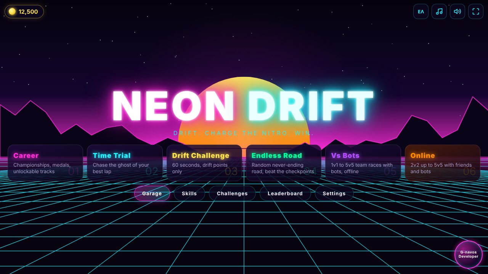

</div>

---

A top-down arcade racer set in a synthwave night. Dark asphalt, pink and cyan barriers, a soundtrack that never stops pulsing. The whole game is built around one thing: drifting. Hold a slide through a corner and your multiplier climbs (x2, x3, x4...), your nitro fills, and you get faster. Clip a wall too hard and the combo is gone.

Race AI rivals in the career, chase your own ghost, or team up with friends online in races from 1v1 up to 5v5.

The game itself uses no image or audio files and no libraries. Every car, track, light and note of music is generated in code.

<table>
  <tr>
    <td>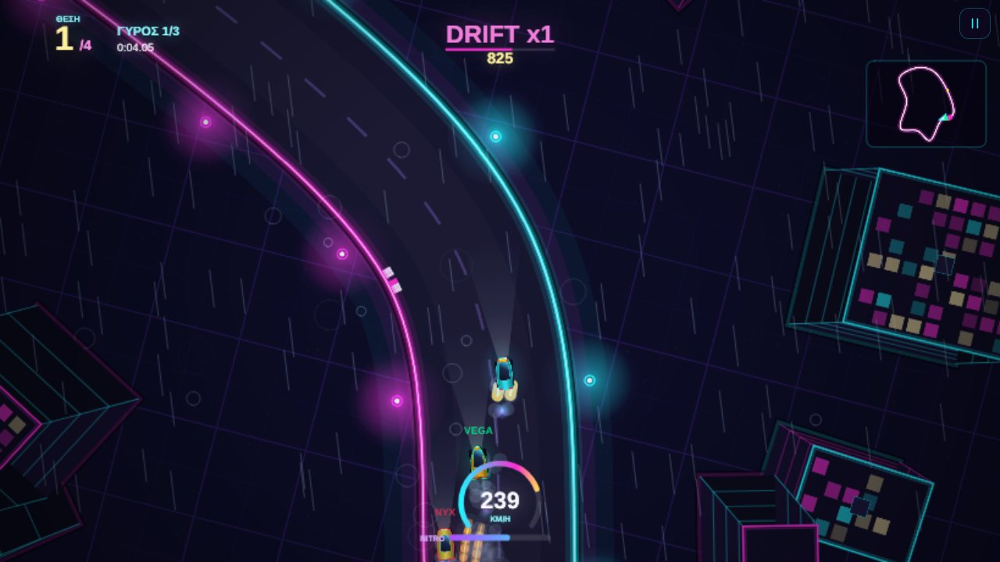</td>
    <td>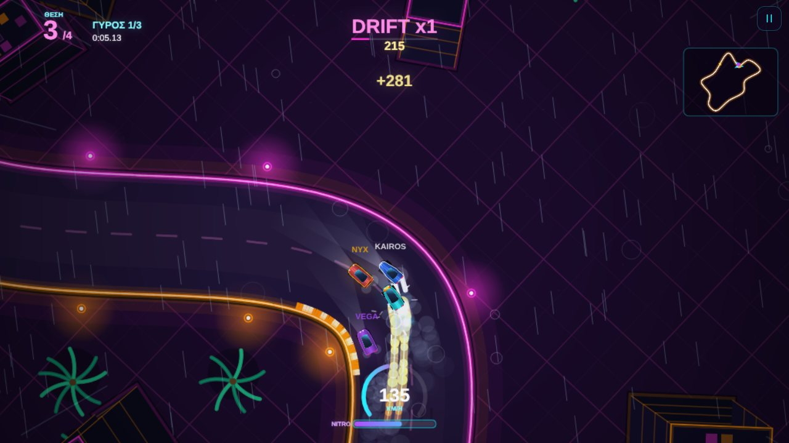</td>
  </tr>
  <tr>
    <td align="center"><sub>Neon City: buildings with real height</sub></td>
    <td align="center"><sub>Rain: wet asphalt, reflections, less grip</sub></td>
  </tr>
  <tr>
    <td>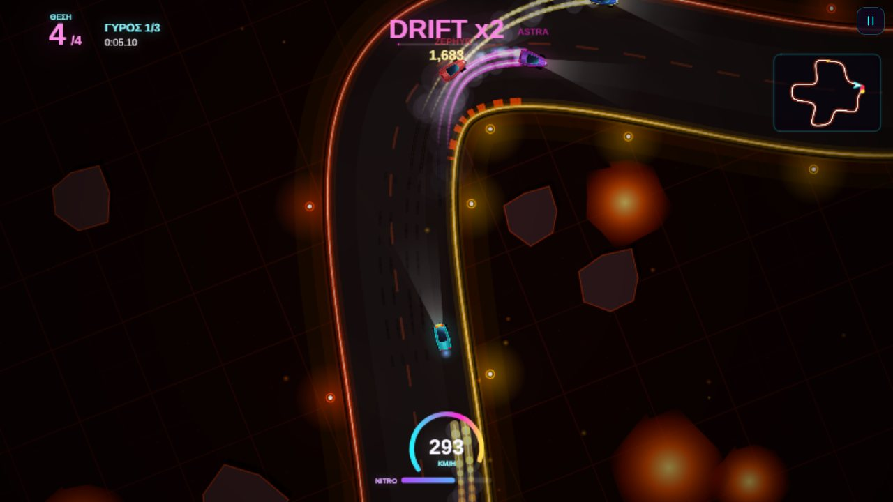</td>
    <td>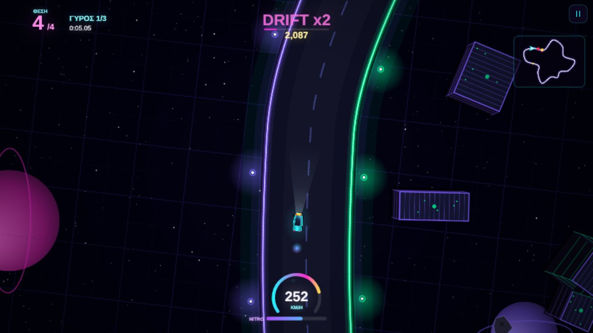</td>
  </tr>
  <tr>
    <td align="center"><sub>Magma Run: lava rivers and drift trails</sub></td>
    <td align="center"><sub>Orbit Station: racing in space</sub></td>
  </tr>
</table>

## Features

**Driving**
- Arcade physics with real weight to it: grip, slip angle, handbrake drifts, counter-steer, power slides
- Drift combo system with a multiplier up to x9, an edge bonus for drifting close to the barriers, and nitro that charges from your drifts
- Boost pads, wall scrapes that cost you speed, car-to-car collisions
- Neon light trails while drifting, tyre marks that stay on the track, sparks, smoke, nitro flames, camera shake and speed zoom
- Smooth camera that turns with the road ahead, never with every twitch of the car, and with a capped rotation speed so it stays comfortable. A tighter chase camera and the classic fixed top-down view are in Settings
- Analog touch steering, vibration feedback on phones and an optional drift assist that counter-steers for you when the car starts to over-rotate

**Game modes**
- **Career**: five cups (Rookie, Pro, Elite, Legend, Cosmic) and 19 races. Finish on the podium to earn stars and unlock the next race, the next cup and new tracks
- **Time Trial**: three laps against the ghost of your best lap, with gold, silver and bronze target times
- **Drift Challenge**: 60 seconds, only drift points count
- **Vs Bots**: offline team races from 1v1 to 5v5 (Race or Drift Battle) with bot teammates and bot opponents, no server needed
- **Endless Road**: a procedurally generated road that never ends. Hit the checkpoints before the clock runs out
- **Online**: team races and drift battles with friends (see below)

## Online with friends

<table>
  <tr>
    <td>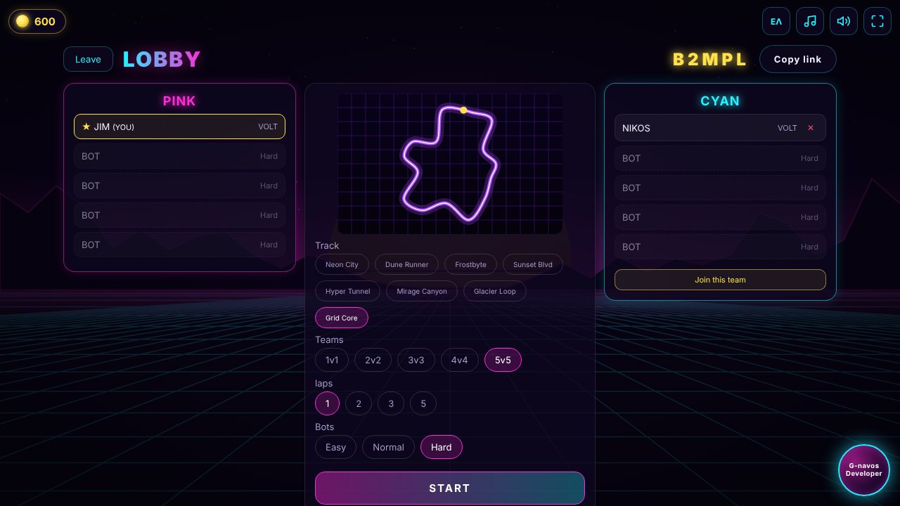</td>
    <td>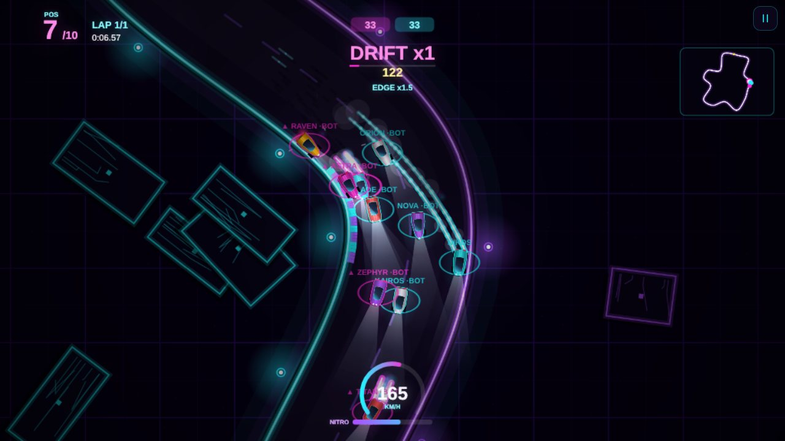</td>
  </tr>
  <tr>
    <td align="center"><sub>Lobby: pink vs cyan, bots fill the empty seats</sub></td>
    <td align="center"><sub>5v5 race with ten cars on track</sub></td>
  </tr>
  <tr>
    <td>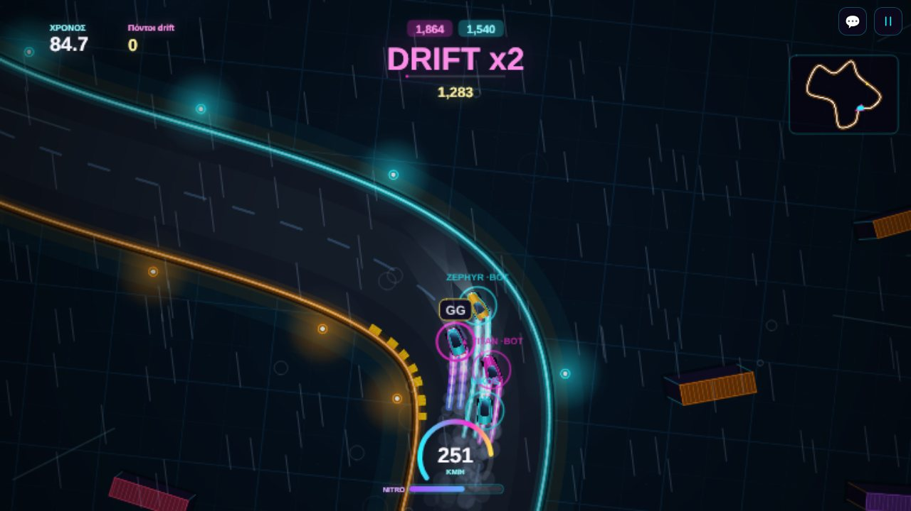</td>
    <td>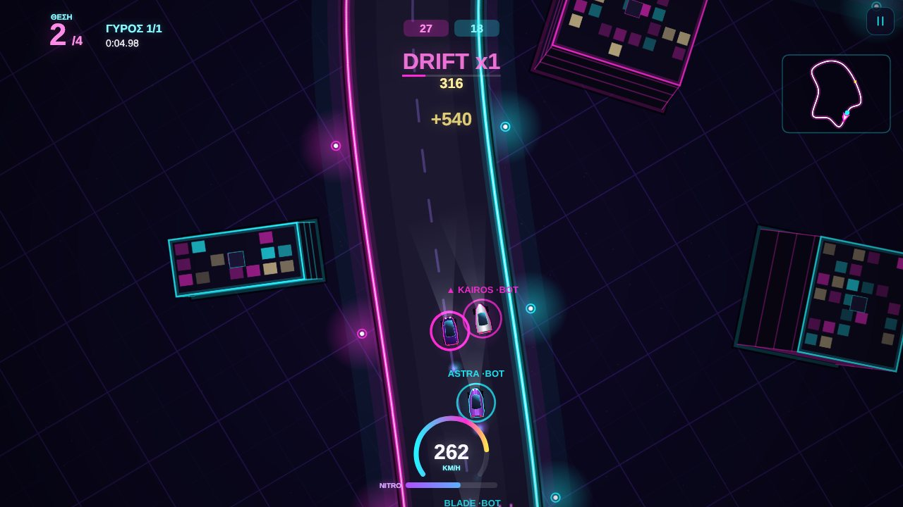</td>
  </tr>
  <tr>
    <td align="center"><sub>Drift Battle: the team with the most drift points wins</sub></td>
    <td align="center"><sub>Vs Bots: the same team races, offline</sub></td>
  </tr>
</table>

- Race with friends in teams: 1v1, 2v2, 3v3, 4v4 or 5v5. Empty seats are filled with bots (easy, normal or hard)
- No accounts and no email. Each player gets a driver profile created on the device, a short **friend code** to share, and a secret **recovery code** to move the profile to another device
- Friends list with online status, friend requests, in-game invites and shareable invite links (`?join=ROOMCODE`)
- Lobby with team selection, track, laps, weather and bot difficulty, all controlled by the host, plus team shuffle and one-click rematch
- Two online modes: team **Race** and **Drift Battle** (90 seconds, the team with the most drift points wins)
- **Quick play** drops you into an open public room, which starts by itself once two players are in
- Quick messages and a horn in the lobby and during the race
- F1-style team scoring (15, 12, 10, 8, 6...), so every finishing position counts
- Survives dropped connections: players rejoin the same race, and if the host leaves the bots are handed to another player

## Tracks and weather

Eleven circuits in nine themes: neon city, sunset boulevard, desert, snow and ice (less grip), a dark tunnel where only your headlights and the lamps cut the dark, a cyber grid, a container harbor, a volcano with lava rivers and floating embers, and an orbital space station.

- Buildings, containers and station modules have real height: their walls and roofs lean away from the camera as you drive past
- Rain: wet asphalt with neon reflections, ripples, spray from the tyres, thunder and lightning, and less grip
- **Daily track**: a new procedural circuit every day, the same for everyone, with a daily world ranking

## Garage, skills and progress

<table>
  <tr>
    <td>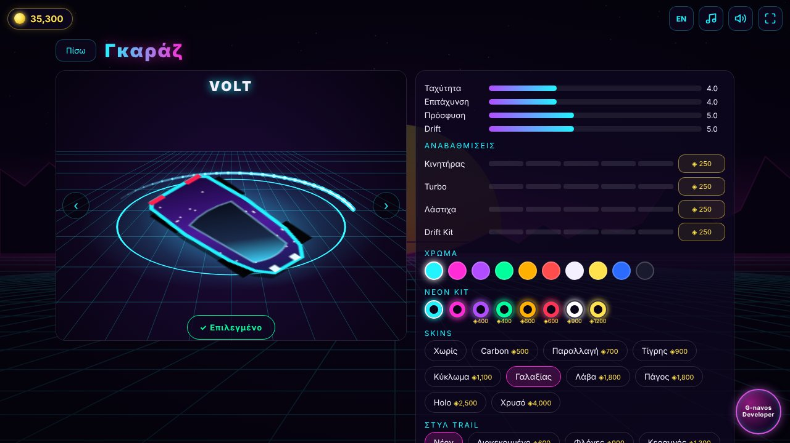</td>
    <td>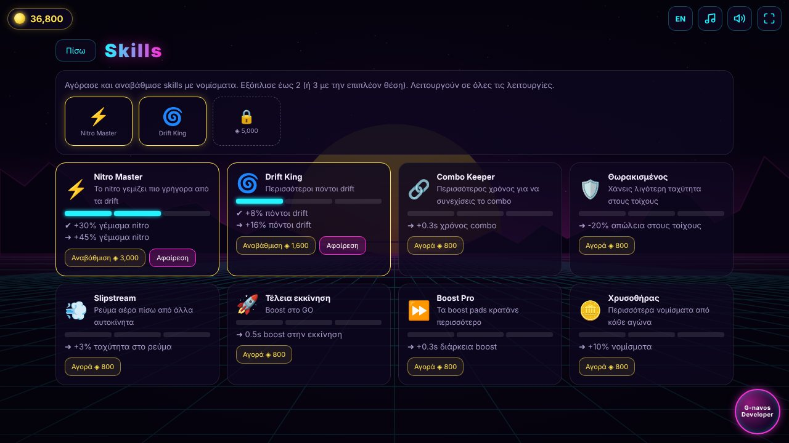</td>
  </tr>
  <tr>
    <td align="center"><sub>Garage: upgrades, paint, neon kits, skins, trails</sub></td>
    <td align="center"><sub>Skills: eight perks with three levels each</sub></td>
  </tr>
  <tr>
    <td>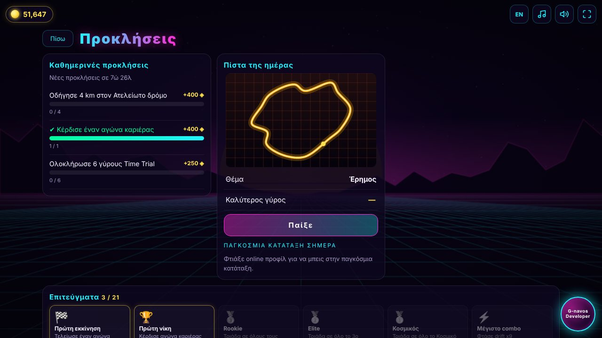</td>
    <td>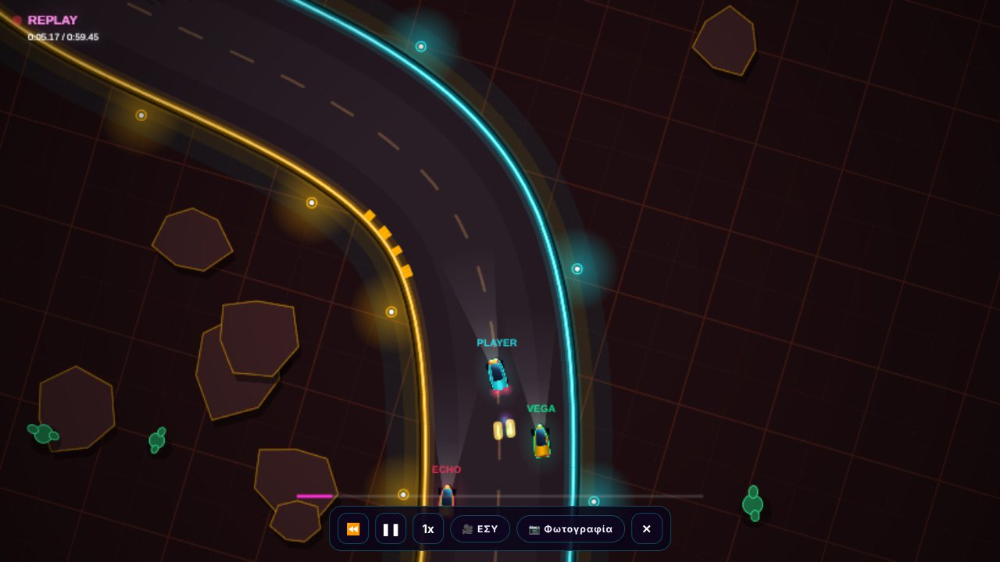</td>
  </tr>
  <tr>
    <td align="center"><sub>Daily challenges, daily track and achievements</sub></td>
    <td align="center"><sub>Replay with camera controls and photo mode</sub></td>
  </tr>
</table>

**Garage**
- Eight cars, each rated on speed, acceleration, grip and drift
- Four upgrade lines (engine, turbo, tyres, drift kit), five levels each
- Ten paint colours and eight neon underglow kits
- Ten body skins (carbon, camo, tiger, circuit, galaxy, lava, ice, holo, gold)
- Trail styles (neon, dashed, fire, lightning, rainbow), decals (stripes, number, checker, flames) and rims (black, chrome, neon, gold)
- Coins come from races, medals, drift points, challenges and achievements

**Skills**
- Eight perks bought and upgraded (3 levels) with coins: Nitro Master, Drift King, Combo Keeper, Armoured, Slipstream, Perfect Launch, Boost Pro and Gold Digger
- Two equip slots, plus a third you can unlock

**Progress**
- Three daily challenges with coin rewards, refreshed every day
- 21 achievements, from your first win to finishing the Cosmic Cup
- Replay of every race with play/pause, speed and camera controls, plus a photo mode that saves a clean screenshot

## Made for phones too

<table>
  <tr>
    <td>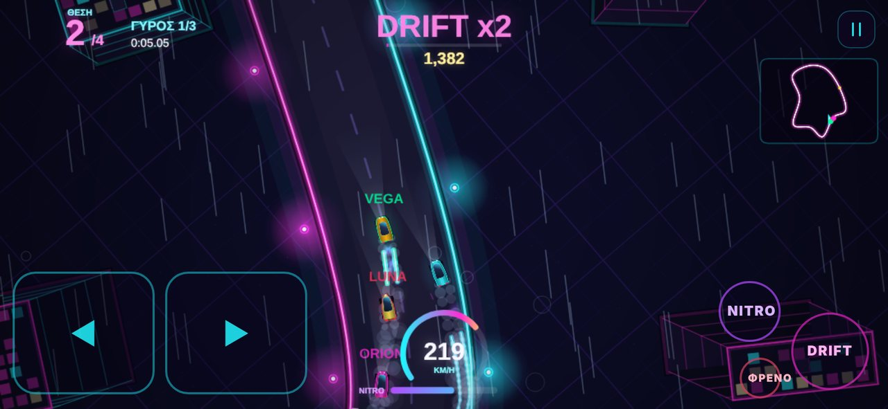</td>
    <td>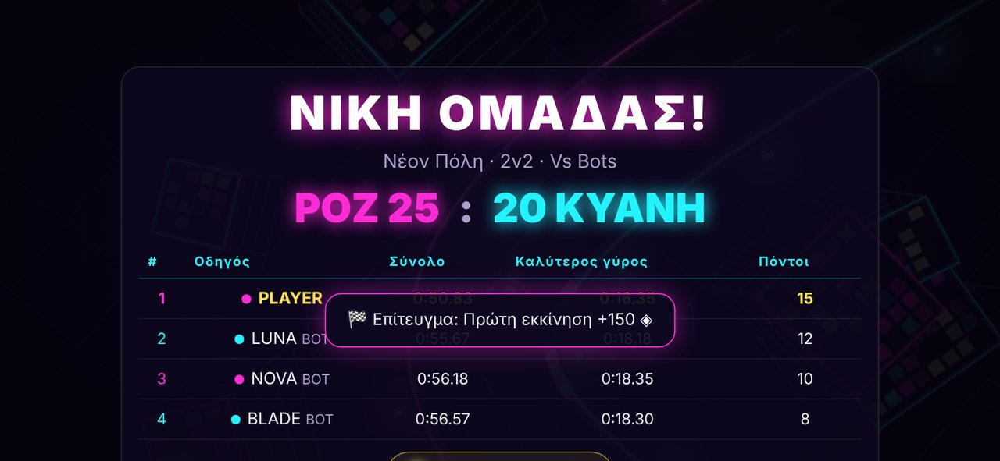</td>
  </tr>
  <tr>
    <td align="center"><sub>Touch controls: analog steering, DRIFT, NITRO, BRAKE</sub></td>
    <td align="center"><sub>Team results on a phone</sub></td>
  </tr>
</table>

- Landscape layout, fullscreen button and safe-area support for notched phones
- Auto throttle on touch so your right thumb stays free for drift and nitro, optional tilt steering
- Installable as an app (PWA) and playable offline
- Resolution drops by itself if a device struggles, to keep the frame rate smooth

## Controls

| Action | Keyboard | Touch |
|---|---|---|
| Steer | ← → or A D | ◀ ▶ pad (or tilt) |
| Throttle | ↑ or W | automatic (can be turned off in Settings) |
| Brake / reverse | ↓ or S | BRAKE |
| Drift (handbrake) | Space | DRIFT |
| Nitro | Shift | NITRO |
| Pause | P or Esc | ❚❚ |

Gamepads work as well: left stick to steer, RT/A for throttle, LT to brake, X/B to drift, RB/Y for nitro.

**Tip:** tap DRIFT as you turn into a corner, keep the throttle on and steer to hold the angle. Chain one corner into the next and the multiplier keeps climbing.

## Tech stack

- One `index.html`: vanilla JavaScript, HTML5 Canvas 2D and CSS
- No frameworks, no build step, no game assets (the only optional network request is Google Fonts, and there are system font fallbacks)
- Procedural graphics: tracks are Catmull-Rom splines sampled into a uniform centreline, rendered into cached 512×512 tiles so the frame cost stays low on phones
- Physics run in fixed sub-steps (around 120 Hz), with the AI driving the same car model as the player
- AI follows a racing line, plans its speed from a curvature profile with braking look-ahead, overtakes, recovers when it gets stuck, uses nitro on straights and can hold drift lines
- Web Audio API for everything you hear: oscillators, filtered noise, a small step sequencer with delay for the music
- HUD, menus, local leaderboards and settings, all saved in `localStorage`
- PWA: `manifest.webmanifest` plus a network-first service worker (`sw.js`)
- Online server: plain Node.js with zero npm dependencies. The WebSocket protocol is implemented by hand on top of `http` and `crypto`
- The server keeps everything in memory (rooms, presence, invites, daily ranking) and stores nothing on disk, so it runs on a free instance with no database. Player identity is derived from the secret code with SHA-256
- Each device simulates its own car and streams its state about 20 times a second. The server relays 20 Hz snapshots, other cars are interpolated with an adaptive delay, and the room host simulates the bots

## Project structure

```
index.html            the whole game
manifest.webmanifest  PWA manifest
sw.js                 service worker (network-first, offline fallback)
icon-180.png          Apple touch icon
icon-192.png          PWA icon
icon-512.png          PWA / maskable icon
package.json          start script for the online server (no dependencies)
server/server.js      online game server (Node.js, zero dependencies)
screenshots/          images used in this README
```

## Running locally

```bash
npm start
```

Then open `http://localhost:8090`. That serves the game and the online server together. Set `LAG_MS=150` to simulate network latency.

For the single-player modes, any static server works too (`npx serve .` or `python3 -m http.server 8080`), and opening `index.html` straight from disk works as well.

## Deploying

The live version runs on a free Render **Web Service**, which serves both the game and the online server:

1. New → Web Service → connect the repository
2. Runtime: Node · Build command: leave empty · Start command: `npm start`
3. Instance type: Free · Region: Frankfurt

The game connects to `https://neon-drift-f0v1.onrender.com` by default (`DEFAULT_SERVER` in `index.html`). A different address can be set in Settings → Online server, and when the game is opened from the Web Service itself it finds the server on its own.

Free instances sleep after 15 minutes without traffic. The server pings its own public URL every 10 minutes to stay awake (set `KEEP_AWAKE=0` to turn that off), and the game starts waking it as soon as it loads. One free service running all month fits inside Render's 750 free hours.

For Android, the folder can be wrapped with Capacitor as it is: point `webDir` at the folder that contains `index.html`.

## Credits

Design and development by **G-navos Developer**
GitHub: [G-Developerr](https://github.com/G-Developerr) · Instagram: [@mhtsos_tzinavos](https://www.instagram.com/mhtsos_tzinavos/)

<div align="center">

### [▶ Play NEON DRIFT](https://neon-drift-f0v1.onrender.com/)

</div>
